<p align="center">
  
</p>

# OpenVitals

**La tua dashboard Android per salute, allenamenti e recupero, con i dati di Health Connect.**

Questa repository distribuisce la versione personalizzata di OpenVitals: dashboard configurabile, periodi giorno/settimana/mese/anno, dettaglio completo degli allenamenti, mappe dei percorsi e importazione da screenshot sul telefono. L’app è solo per Android: Health Connect esiste solo su Android.

## PWA nel browser

La cartella [`web/`](web/README.md) contiene la PWA con dashboard ad anelli, riquadri modificabili, periodi giorno/settimana/mese/anno, dettagli dei parametri, attività, profilo, impostazioni e backup. È installabile dalla schermata Home e dispone di cache offline. I dati demo vengono inseriti manualmente e restano nel browser: non sono richiesti account, Health Connect o HealthKit.

Il catalogo dei riquadri riprende automaticamente nomi, colori e ordine dal codice Android durante la build. La [guida web](web/README.md) descrive le funzioni portate e quelle Android ancora non presenti. Il workflow **OpenVitals Web** compila e verifica la PWA su `main_claude` e `main`, senza pubblicarla: per provarla si compila in locale (vedi la [guida web](web/README.md)). La compilazione Android rimane indipendente; `web/` non entra nell'APK.

## Scarica l’app

[](https://github.com/lorenzomp7/OpenVitals/releases/latest/download/OpenVitals.apk)
[](https://github.com/lorenzomp7/OpenVitals/releases)

### [⬇ Scarica OpenVitals.apk](https://github.com/lorenzomp7/OpenVitals/releases/latest/download/OpenVitals.apk)

Scarica l’APK direttamente dal link qui sopra: non servono un computer, Android Studio o l’accesso a GitHub Actions.

Ogni release contiene l’APK installabile, il checksum SHA-256 e i collegamenti al codice sorgente e alla compilazione verificata. Le release sono build di sviluppo personali: consulta le note della versione che stai scaricando. Le modifiche presenti nel branch possono essere più recenti dell’ultima release.

## Installazione e aggiornamenti

1. Apri il link **Scarica APK** dal telefono Android.
2. Scarica e apri **OpenVitals.apk**.
3. Se Android lo richiede, autorizza l’installazione da questa sorgente per il browser o il gestore file utilizzato.
4. Avvia OpenVitals e concedi in Health Connect i permessi per le categorie che vuoi visualizzare.

Per aggiornare, scarica il nuovo APK dallo stesso link e installalo sopra la versione personale compatibile. La firma e l’identificativo dell’app sono mantenuti per consentire gli aggiornamenti senza disinstallazione.

| File o distribuzione | A cosa serve |
| --- | --- |
| **OpenVitals.apk** nelle Releases | L’app da installare sul telefono; identificativo `tech.mmarca.openvitals.debug`. |
| `app-ci.apk` negli artefatti di verifica | Una diversa installazione per i test, con firma temporanea. |
| APK `androidTest` | Il programma che esegue i test; non è l’app per l’utente. |
| Versioni upstream Play Store / F-Droid | Distribuzioni del progetto originale, separate da questa versione personalizzata. |

Se Android rifiuta un aggiornamento, controlla di aver scaricato l’APK personale e di avere una versione con firma compatibile. [Dettagli su firma e verifica degli aggiornamenti](https://github.com/lorenzomp7/OpenVitals/blob/main_claude/docs/engineering/personal-build.md).

## Cosa offre questa versione

Le funzioni qui sotto descrivono il [branch `main_claude`](https://github.com/lorenzomp7/OpenVitals/tree/main_claude), che contiene gli aggiornamenti Android più recenti. Il riepilogo del toggle segue il periodo selezionato. Nei dettagli attività i grafici si possono anche nascondere e ripristinare.

| Area | Funzioni |
| --- | --- |
| **Dashboard** | Griglia a quattro colonne con riquadri 1×1, 2×1 e 2×2, da riordinare trascinandoli e ridimensionare; numero di dettagli per riquadro (2 o 3) scelto per ciascuno. Ogni riquadro mostra dettagli legati a ciò che misura: obiettivo, categoria (BMI, FFMI, pressione), valore di riferimento personale (FC a riposo, HRV), massa grassa, ripartizione dei macronutrienti e le metriche collegate. Anelli in evidenza in alto, pagine laterali, pulsanti per avviare un allenamento e registrare dati, tema chiaro e scuro. |
| **Periodi** | Giorno, settimana, mese e anno, con navigazione avanti/indietro; totali, medie e obiettivi scalati secondo il tipo di metrica. |
| **Allenamenti** | Cronologia nella dashboard e dettaglio per ogni attività con grafici da riordinare e aprire a schermo intero: frequenza cardiaca e zone (per ogni sport), passo o velocità, passo del nuoto ogni 100 m, giri e vasche, parziali, altitudine con salita, discesa e pendenza, cadenza e lunghezza del passo, effetto allenamento, serie di forza, salto con la corda, record personali e recupero stimato. |
| **Percorsi e mappe** | Percorsi GPS salvati su cartografia Mapbox configurata sul telefono, con altitudine dal modello del terreno; anteprima locale del tracciato senza mappa. |
| **Sonno e recupero** | Sessioni e fasi del sonno, punteggio del sonno, Daily Readiness, Body Energy e carico cardio settimanale. |
| **Corpo e parametri vitali** | Peso, altezza, BMI, FFMI, composizione corporea, metabolismo basale, frequenza cardiaca e HRV, pressione, SpO₂, VO₂ max, frequenza respiratoria, temperatura corporea e cutanea, glicemia. |
| **Alimentazione** | Calorie, proteine, carboidrati, grassi, bevande e idratazione, caffeina assunta e caffeina ancora attiva. |
| **Altro** | Mindfulness, ciclo, cartella clinica (FHIR), riquadro dell'orologio OpenWatch con sincronizzazione. |
| **Inserimento e importazione** | Registrazione delle attività, inserimento manuale, importazione da screenshot con OCR sul telefono e anteprima da correggere, importazione Apple Health e CSV, sincronizzazione Bluetooth tra due telefoni. |
| **Report** | Report PDF generato sul telefono. |

I dati dipendono dai permessi e da ciò che le app dei tuoi dispositivi scrivono effettivamente in Health Connect. OpenVitals non può mostrare una misurazione rimasta soltanto nell’app del produttore.

Le note di ciascuna [release](https://github.com/lorenzomp7/OpenVitals/releases) elencano le novità di quella versione e il commit da cui è stata compilata.

## Prima configurazione di Health Connect

Health Connect è il servizio Android che raccoglie sul dispositivo i dati condivisi dalle app compatibili e ti permette di decidere quali app possono leggerli o scriverli. I dati possono provenire da smartwatch, telefono, bilance e altri dispositivi, oppure da inserimenti manuali e importazioni. OpenVitals legge i dati presenti in Health Connect e, con i permessi necessari, può salvarvi nuovi dati. Per visualizzare quelli di un’altra app, abilita la sua condivisione con Health Connect e autorizza OpenVitals a leggerli.

1. **Apri Health Connect.** Su Android 14 o successivi cerca “Connessione Salute” nelle Impostazioni; su Android 13 o precedenti compatibili installa [l’app ufficiale dal Play Store](https://play.google.com/store/apps/details?id=com.google.android.apps.healthdata). Completa l’avvio iniziale.
2. **Apri l’app che contiene i tuoi dati**, sincronizza gli eventuali dispositivi e abilita il collegamento a Health Connect.
3. **Controlla le autorizzazioni app** in Health Connect: consenti all’app del produttore di **scrivere** le categorie desiderate.
4. **Apri OpenVitals** e concedi la **lettura** delle stesse categorie. Abilita la scrittura se vuoi salvare inserimenti o importazioni; autorizza anche l’accesso allo storico, quando disponibile e richiesto.
5. **Verifica un dato recente** in Health Connect, nella sezione dati, prima di cercarlo in OpenVitals. Poi riapri o aggiorna la dashboard.

I nomi dei menu possono cambiare con telefono, lingua e versione dell’app.

### Importare lo storico da altre app

Per recuperare i dati precedenti segui le [guide all’importazione dello storico](docs/how-to/import-storico/README.md), con una pagina dedicata a ciascuna app e le indicazioni su permessi, formati e verifica dei risultati.

## Mappe

- **Mapbox:** la configurazione avviene sul telefono. Nessun token Mapbox è incluso nel sorgente o nell’APK. [Configurazione mappe e comportamento offline](https://github.com/lorenzomp7/OpenVitals/blob/main_claude/docs/engineering/mapbox.md).
- **Senza cartografia:** resta disponibile l’anteprima locale del percorso GPS salvato.

## Dati e privacy

Non è richiesto un account OpenVitals. I dati sanitari sono letti da Health Connect ed elaborati sul dispositivo; le scritture avvengono tramite le azioni di salvataggio, importazione o sincronizzazione avviate o abilitate dall’utente.

Questa versione utilizza Internet per la cartografia e l’accesso Mapbox. Le richieste delle mappe comunicano con il fornitore della cartografia; non viene introdotto un server OpenVitals a cui caricare i dati sanitari. Le credenziali Mapbox sono conservate localmente in forma cifrata.

OCR e generazione dei report vengono eseguiti sul telefono. Le valutazioni di recupero sono informazioni derivate dai dati disponibili e non diagnosi mediche.

## Release e sviluppo

L’APK viene compilato dal branch [`main_claude`](https://github.com/lorenzomp7/OpenVitals/tree/main_claude). Per i push che aggiornano la configurazione di rilascio e per le esecuzioni manuali, il workflow **publish-personal-release** esegue la verifica completa, firma l’APK con la chiave personale, controlla che la firma coincida con quella dell’APK pubblicato prima, lo installa come aggiornamento su un emulatore Android 15 e solo allora pubblica la release.

- [APK, versioni precedenti e note](https://github.com/lorenzomp7/OpenVitals/releases)
- [Codice della versione personalizzata](https://github.com/lorenzomp7/OpenVitals/tree/main_claude)
- [Compilazioni e verifiche](https://github.com/lorenzomp7/OpenVitals/actions/workflows/publish-personal-release.yml)
- [Segnala un problema in questa repository](https://github.com/lorenzomp7/OpenVitals/issues)
- [Guida tecnica delle build personali](https://github.com/lorenzomp7/OpenVitals/blob/main_claude/docs/engineering/personal-build.md)

Per compilare in locale: clona la repository con i sottomoduli, seleziona `main_claude` e usa Android SDK 37 e JDK 17 o 21.

```bash
git clone --recurse-submodules --branch main_claude https://github.com/lorenzomp7/OpenVitals.git
cd OpenVitals
./gradlew :app:assembleDebug
./gradlew verifyCi
```

## Licenza

OpenVitals è distribuito con licenza [GNU AGPL v3.0 o successiva](LICENSE). Crediti e componenti di terze parti sono elencati in [THANKS.md](THANKS.md) e [THIRD_PARTY_NOTICES.md](THIRD_PARTY_NOTICES.md).

## Strumenti di sviluppo AI

Sono integrati `agent-skills`, `container-use`, Gemini CLI, Playwriter e `vibetest-use`, con versioni fissate e strumenti separati dalle dipendenze dell’app.
Sono disponibili anche la ricerca locale nei cataloghi `awesome-mcp-servers` e `awesome-ai-plugins`, e uno strumento Darts separato per previsioni sperimentali da CSV o backup PWA. I cataloghi non installano automaticamente i servizi elencati e le previsioni non sono una funzione dell’APK.
Vedi [configurazione, comandi e requisiti](docs/engineering/ai-tools.md) e [verifiche automatiche](https://github.com/lorenzomp7/OpenVitals/actions/workflows/ai-tools.yml).
Gemini e Vibetest richiedono autenticazione o chiave del modello per le richieste AI; Container Use richiede Docker; Playwriter richiede Chrome/Chromium.
